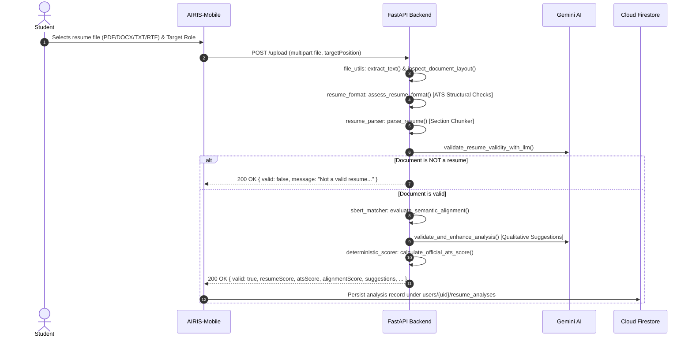

# AIRIS Architecture & Execution Flows

This document details the system topology, component responsibilities, boundary contracts, and critical execution flows across AIRIS.

---

## 1. System Topology & Authority Boundaries

AIRIS is a multi-tier platform comprising four distinct execution environments:

```
┌─────────────────────────────────────────────────────────────┐
│                       FastAPI Backend                       │
│  - Authoritative Scoring & ATS Analysis                     │
│  - Authoritative 10-turn Interview Progression Engine       │
│  - Bounded AI Validation (Gemini) & Semantic Match (SBERT)  │
│  - Audio Transcription & Speech Analysis                    │
└──────────────────────────────▲──────────────────────────────┘
                               │ HTTPS / JSON / Multipart
                               │ Bearer <Firebase ID Token>
        ┌──────────────────────┴──────────────────────┐
        │                                             │
┌───────┴─────────────────┐               ┌───────────┴─────────────┐
│   AIRIS-Mobile (Expo)   │               │   AIRIS-Web (Next.js)   │
│ - Student Client App    │               │ - Administrator Portal  │
│ - Session Orchestration │               │ - OJT Coordinator View  │
│ - Local State (Zustand) │               │ - Institutional Metrics │
└───────────────▲─────────┘               └─────────────┬───────────┘
                │ UaaL Bridge (JSON)                    │
                │                                       │
┌───────────────▼─────────┐                             │
│    Unity Subsystem      │                             │
│ - 3D Interviewer Avatar │                             │
│ - Cardboard VR Render   │                             │
│ - Native Audio & TTS    │                             │
└─────────────────────────┘                             │
        │                                               │
        └──────────────────────┬────────────────────────┘
                               │ Direct Firestore SDK
                               ▼
┌─────────────────────────────────────────────────────────────┐
│                    Firebase / Cloud Firestore               │
│ - Authentication (Identity Provider)                        │
│ - Collections: users, resumes, interviews, activities       │
│ - Cloud Storage: Raw uploaded resume documents              │
└─────────────────────────────────────────────────────────────┘
```

### Authority Matrix

| Concern | Authoritative Layer | Supporting Layer | Rationale |
| :--- | :--- | :--- | :--- |
| **Identity & Authentication** | Firebase Auth / Admin SDK | Client state (`authStore`) | Tokens verified authoritatively via public Google certs or Firebase Admin. |
| **Resume ATS & Alignment Score**| FastAPI Backend (`deterministic_scorer.py`)| Mobile UI | Prevents client-side manipulation of academic capstone evaluation scores. |
| **Interview Turn & Question Logic**| FastAPI Backend (`interview_engine.py`) | Mobile (`interviewStore`)| Preserves the fixed 10-question sequence and follow-up boundary. |
| **3D Rendering & In-VR Voice** | Unity C# Presentation Layer | React Native bridge | Unity renders avatars and streams audio; never calculates scores. |
| **Completed Interview Persistence** | FastAPI Admin SDK → Cloud Firestore | Client cache | Server session state supplies evaluations; atomic transactions write the report and activity. Legacy records retain their original provenance. |

---

## 2. Critical Execution Flows

### Flow 1: Resume Upload & Analysis Flow



### Flow 2: Immersive VR Interview Simulation Flow

```mermaid
sequenceDiagram
    autonumber
    participant Mobile as AIRIS-Mobile (RN)
    participant Unity as Unity UaaL Bridge
    participant Backend as FastAPI Backend
    participant Firestore as Cloud Firestore

    Mobile->>Unity: postToUnity("LOAD_SCENE", { sceneName: "OneOnOneOffice" })
    Unity-->>Mobile: onUnityMessage("SCENE_LOADED")
    Mobile->>Backend: POST /interview/start { targetRole, program, parsedResume }
    Backend->>Firestore: Create private UID-owned interview session
    Backend-->>Mobile: { sessionId, turn: 0, questionId: "survey-1", question }
    Mobile->>Unity: postToUnity("SHOW_QUESTION", { questionText, speakerName })
    Unity->>Unity: Displays bubble & speaks question via TTS
    Unity-->>Mobile: onUnityMessage("QUESTION_SPOKEN")
    Mobile->>Unity: postToUnity("START_RECORDING")
    Unity->>Unity: Records mic audio until 5s post-speech silence or threshold
    Unity-->>Mobile: onUnityMessage("RECORDING_STOPPED")
    Unity-->>Mobile: onUnityMessage("TRANSCRIPT_READY", { audioPath / transcript })
    Mobile->>Backend: POST /interview/transcribe (audio, sessionId, turn)
    Backend-->>Mobile: { transcription, pauseMetrics }
    Mobile->>Backend: POST /interview/answer { sessionId, questionId, turn, currentAnswer }
    Backend->>Firestore: Commit answer/evaluation and replay receipt
    Backend-->>Mobile: { nextQuestion, evaluation, isComplete }
    alt Fewer than nine scored answers
        Mobile->>Unity: postToUnity("SHOW_QUESTION", { nextQuestion })
    else Ninth answer evaluated
        Mobile->>Unity: SHOW_QUESTION (Q10 unscored closing; no recording)
        Unity-->>Mobile: QUESTION_SPOKEN (closing delivered)
        Mobile->>Backend: POST /interview/report { sessionId }
        Backend->>Firestore: Atomically persist completed interview, activity, retry receipt
        Backend-->>Mobile: Final report with persisted:true
    end
```

---

## 3. Resilience, Concurrency, and Watchdogs

### 1. Immersive Bridge Watchdogs
To guarantee the candidate is never stuck in VR:
- **Scene Load Watchdog:** If Unity fails to fire `SCENE_LOADED` within 10 seconds, the mobile host retries scene loading or displays an error overlay.
- **Listening Safety Timer:** If silence detection stalls during user recording, a 35-second hard safety timer dispatches `postToUnity("STOP_RECORDING")`.
- **Handoff Watchdog:** If `TRANSCRIPT_READY` is not received within 20 seconds of `RECORDING_STOPPED`, the screen resets state to prevent deadlocks.

### 2. Idempotent Interview Exit (`handleStopInterview`)
- Terminating an interview is an atomic lifecycle transition.
- Aborts active HTTP requests via `AbortController`.
- Cancels all pending timers (scene loading, listening safety, watchdog).
- Dispatches `postToUnity("STOP_RECORDING")` and `postToUnity("SESSION_EXIT")`.
- Restores mobile screen orientation to portrait (`AirisOrientation.lockPortrait()`).
- Sends authenticated `/interview/cancel`; server transactions reject late answer/report commits after cancellation.
- Never writes artificial scores or answers to database upon cancellation. Offline cancellation remains unconfirmed remotely; unfinished state expires.

### 3. Backend Rate Limiting & Concurrency Guard
- Rate limits enforced in [`AIRIS-Backend/rate_limiter.py`](file:///Users/danieltan/Desktop/AIRIS/AIRIS-Backend/rate_limiter.py):
  - General endpoints: 60 req/min per UID.
  - Expensive endpoints (`/analyze`, `/interview/transcribe`): 10 req/min per UID.
  - Concurrency Guard: `ExpensiveConcurrencyGuard` rejects overlapping expensive operations for the same user with HTTP 429.

### Account lifecycle authority (local continuation, rollout pending)

The Admin Web server owns registration/profile initialization, voluntary deletion, and administrative restriction transitions through `/api/accounts/lifecycle`. Firebase Auth remains the credential and token authority; server-only `account_lifecycle` records bind normalized email hashes to trusted lifecycle states across replacement UIDs. FastAPI validates current persisted student restrictions before protected operations. Mobile performs presentation/local cleanup and cannot choose deletion origin or recreate a protected profile directly. Firestore rules reserve lifecycle/identity writes to the server and restrict deleted/disabled history access. The legacy migration defaults closed; see `ACCOUNT_LIFECYCLE_MIGRATION.md` before any coordinated deployment. This security/data-boundary change must be reflected in the capstone architecture and privacy/retention documentation.
